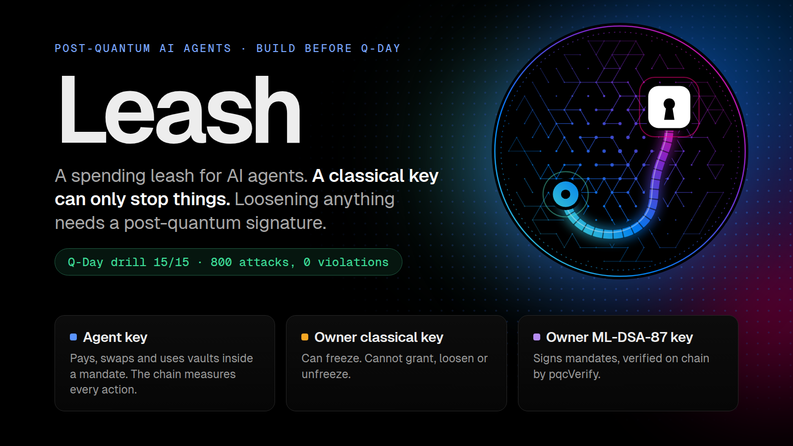

# Leash

**A spending leash for AI agents on QoreChain. A classical key can only stop things. Starting or loosening anything needs a post-quantum signature.**

Built for QoreChain Developer Fest, "Build Before Q-Day", Post-Quantum AI Agents track. Testnet only (`qorechain-diana`).



**Demo video (2:18, captions):** https://david-film-library.pages.dev/media/leash-demo.mp4

## The problem

An AI agent that pays for things holds a key, and today that key is secp256k1. If it leaks, or is broken by a quantum computer, the agent can be drained. Giving the agent a spending limit does not help if the same classical key can raise the limit.

QoreChain's own rules help, but they have traps. From its docs: a missing or disabled spending rule means **no limit**, not zero. An ERC-20 transfer counts as **zero value** inside an EVM window, and allowed targets do not cap token amounts. Windows are capped at 17,280 blocks (about 6 hours). Leash closes these gaps, and tells you the ones it cannot close.

## The idea in one rule

| Who | May do | May not do |
|---|---|---|
| The agent (secp256k1 key) | Spend inside a mandate: per-payment and daily caps, allowlisted recipients, until an expiry. Freeze itself. | Change anything about its own mandate |
| The owner's classical key | **Freeze.** It can only stop things. | Grant, loosen, extend or unfreeze |
| The owner's ML-DSA-87 key | Sign a mandate: a new agent, new limits, new recipients, unfreeze | (Everything else is on the owner) |

A mandate takes effect only when `LeashGuard` verifies an ML-DSA-87 signature on chain through QoreChain's `pqcVerify` precompile. The signed message binds the chain id, this guard, a nonce and the whole mandate, so a signature cannot be replayed on another chain or guard, used twice, or altered.

## What is in the repo

- `src/LeashGuard.sol`: the guard that holds funds and enforces the mandate.
- `tools/policy.ts`: write the leash in plain English, get a validated mandate, an on-chain plan, and a list of findings (errors, warnings, and gaps the chain does not enforce).
- `tools/attack.ts`: the **Q-Day drill**. It plays a leaked agent key and a leaked owner key against the guard.
- `tools/testnet.ts`: the pipeline for the real testnet (register keys, open windows, deploy, sign and apply a mandate, run the drill).
- `tools/local.ts`: the same flow on a local Anvil node with the precompiles stubbed, no wallet needed.
- `mcp/`: an MCP server and agent skill so Hermes Agent, Claude Code, Cursor and others can pay through the guard. See [mcp/README.md](mcp/README.md).

## Try it

Requires [Foundry](https://getfoundry.sh), Node 22 and pnpm.

```sh
pnpm install
forge install foundry-rs/forge-std --no-git
pnpm test                 # 21 contract tests + 10 compiler tests
pnpm demo:local           # the full flow and the drill on a local node
pnpm compile "agent 0x70997970C51812dc3A010C7d01b50e0d17dc79C8 up to 3 QOR a day, at most 1 QOR per payment, only to 0x90F79bf6EB2c4f870365E785982E1f101E93b906 for 3 hours"
```

The compiler refuses what it cannot parse exactly and says so loudly when it applies a default:

```
LEASH REFUSED
  [error] Say who the agent may pay: 'only to 0x… and 0x…'. An empty allowlist means the agent can spend nothing.
  [error] Give at least one cap: '50 fUSD a day' or 'at most 20 fUSD per payment'.
```

## Use it from an agent

Leash ships an MCP server (`leash_status`, `leash_check`, `leash_pay`, `leash_freeze`, `leash_compile`, `leash_loosen_prepare`, `leash_drill_local`) and a skill. The agent holds only its own key; there is no tool that loosens a mandate. Setup for Hermes Agent, Claude Code and Cursor is in [mcp/README.md](mcp/README.md). Trading and bridging are not guarded yet, and the doc says why.

## What was proven, and where

| Check | Result |
|---|---|
| Contract tests (Foundry, stubbed precompiles) | 21 of 21 pass, including a fuzz test that the agent never moves more than the daily cap |
| Compiler tests | 10 of 10 pass |
| Q-Day drill, local node | 14 of 14 as expected |
| **Mutation check**: break the guard on purpose | The drill fails each time: no per-payment cap (13/14), no post-quantum check (9/14), owner key allowed to spend (13/14) |
| **Real testnet**: `applyMandate` with a real ML-DSA-87 signature | Accepted by the `pqcVerify` precompile |
| **Real testnet**: Q-Day drill | 13 of 13 as expected |
| **Real testnet**: an MCP client pays through the guard | A 0.1 QOR payment succeeded; 5 QOR and an off-allowlist address were refused by the chain ([transcript](reports/mcp-live-demo.json)) |

On the testnet, guard [`0xa0ebb5daf8229da498346f0c824276d126c2a34c`](https://explore.qore.network/address/0xa0ebb5daf8229da498346f0c824276d126c2a34c) was deployed in `0x1670f698…9669` and armed in `0x53d44e69…14ae`; full hashes are in [`reports/testnet-drill.json`](reports/testnet-drill.json). The drill ends by freezing the guard; `pnpm testnet rearm` later re-armed it with a second owner-signed ML-DSA-87 mandate (nonce 2) for the MCP demo.

### The drill

For each attempt the expected result is stated first. A legitimate payment must succeed, so a guard that refuses everything cannot pass, and the freeze kill switch must work.

```
PASS  control   legitimate payment inside the mandate                        succeeded
PASS  agent key pay more than the per-payment cap                            blocked (OverPerTxLimit)
PASS  agent key pay an address that is not on the allowlist                  blocked (RecipientNotAllowed)
PASS  agent key pay in a token the mandate does not cover                    blocked (TokenNotSpendable)
PASS  agent key keep paying after the daily cap                              blocked (OverDailyLimit)
PASS  agent key loosen the mandate with a forged post-quantum signature      blocked (BadPqcSignature)
PASS  agent key loosen the mandate with a signature for a different mandate  blocked (BadPqcSignature)
PASS  agent key replay the owner's signature from a different guard          blocked (BadPqcSignature)
PASS  owner key spend directly                                               blocked (NotAgent)
PASS  owner key grant itself a bigger mandate (no post-quantum signature)    blocked (BadPqcSignature)
PASS  owner key freeze the guard (the kill switch)                           allowed
PASS  agent key keep paying after the freeze                                 blocked (IsFrozen)
PASS  owner key unfreeze with an old signature                               blocked (BadPqcSignature)
```

## Honest limits

- **Simulated blocks.** On the testnet, the "blocked" rows are simulated calls that revert as expected. Only the legitimate payment, the freeze and the mandate itself are real transactions.
- **Native QOR on testnet.** The testnet run uses native QOR. Token limits (the gap the chain's window leaves open) are proven locally with a mock token, not on chain.
- **Expiry is checked locally only.** It needs a clock that can be moved.
- **The guard is not audited.** It is small and heavily tested, but it has not had an independent review.
- **Funds outside the guard are not covered.** Keep the agent's own account near zero.
- **The daily cap is a fixed 24-hour bucket,** not a rolling window.
- **Windows must be renewed.** The chain caps an EVM window at about 6 hours, so a long mandate needs a keeper holding the agent account's ML-DSA-87 key. On the testnet run, one machine held both keys for convenience; in a real deployment the agent's runtime should hold only its secp256k1 key.
- **Owner post-quantum key loss is final.** If the owner's ML-DSA-87 key is lost, a mandate cannot be changed. The kill switch still works.
- **Testnet only.** The `pqcVerify` precompile and the authenticator module are not active on mainnet.

## How the chain's own layers fit

Leash is defence in depth, not a replacement. The chain's EVM window (opened by a hybrid-signed native message) bounds the agent account's EVM transactions by time, count and target. `LeashGuard` then bounds what those transactions can do to the money. The plan Leash prints includes the window settings, scoped to the guard.

## Credits

The `pqcVerify` and `pqcKeyStatus` usage, the idea of reading the signer's public key from the chain's key registry, and the stand-in precompile used in the Foundry tests follow the organisers' [`qday-vault`](https://github.com/qorechain/build-before-qday) sample (Apache-2.0). `forge-std` is used for tests. See [AI_USAGE.md](AI_USAGE.md) for how this was built.

## Licence

Apache-2.0. See [LICENSE](LICENSE).
